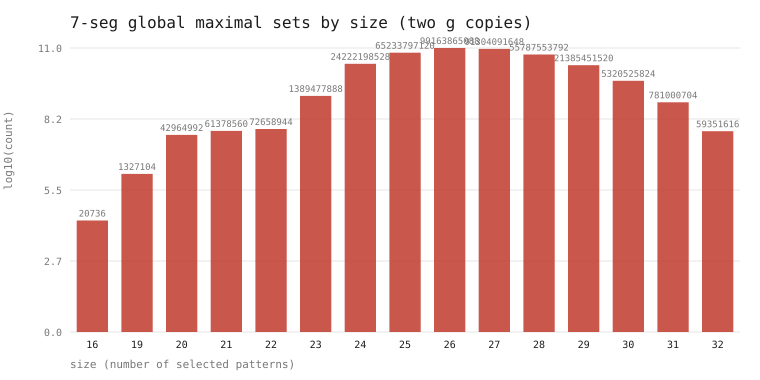
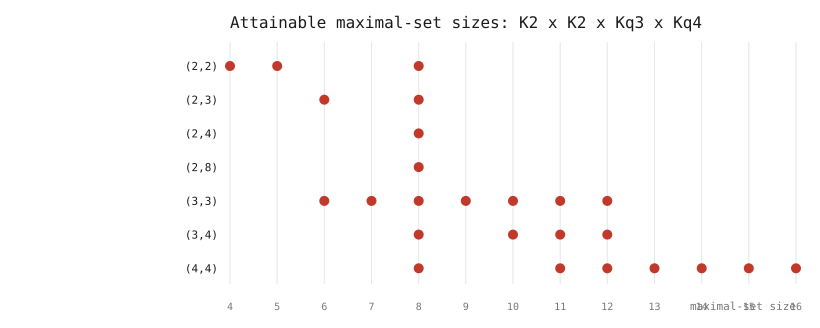

<p align="center">
  
</p>

# cov7seg

**Which glyph sets stay unambiguous when any one side of a seven-segment display is covered?** This repository answers that exactly, then generalizes the answer to other grids and character sets.

Status: **M3 — interactive lab (shipped MVP)**.  M1 (exact combinatorics, general engine, capacity) and M2 (well-covered criterion, topology, nearest-standard check, font Pareto) are shipped.  The static lab is now in `index.html`; the quiz it hosts is the human-calibration harness.

The motivating case: a thin object covers one side of a traffic countdown.  The outermost line disappears, and the remaining pattern can be a different valid digit.  The 2024 *Journal of Vision* study of occluded countdown numerals documents the resulting 6/8 bistability.

## What the foundation found

| result | value |
|---|---|
| maximum unambiguous 7-segment set | **32** |
| minimum maximal set | **16** |
| attainable maximal sizes | **16, 19–32** (17 and 18 do not exist) |
| per-`g` sizes (64 patterns) | **8, 11–16** (9 and 10 do not exist) |
| maximal sets per `g` / globally | **604,008** / **364,825,664,064** |
| 7-segment character capacity | **32** (decimal and hex fit; 36-letter alphanumeric and Base64 do not) |
| construction rule | 4 cells × a matching of `K₄,₄`, plus cross-cell disjointness and hole-covering |

The 9/10 gap is not a mysterious sequence.  The feasible cell-size patterns are a finite grammar; 9 and 10 are simply absent.  A one-parameter family `K₂ □ K₂ □ K_q □ K_q` shows the gap moving and sometimes disappearing (some members are well-covered).  See [docs/FOUNDATION.md](docs/FOUNDATION.md) for the tables, proofs sketches, and open questions.

<p align="center">
  
</p>

## M2 so far

- **Well-covered theorem.**  `K_{q1} □ … □ K_{qd}` is well-covered iff
  `q1 > Σ_{i≥2}(q_i − 1)`.  For 7-segment `4 > 5` is false, so the graph is
  not well-covered — the 9/10 gap is a consequence.  The proof and the
  exact/CP-SAT verification are in [docs/FOUNDATION.md](docs/FOUNDATION.md).
- **Topology is objective and necessary — but not sufficient.**
  A geometry-based `(components, holes)` signature recovers 0/6/9 = one hole,
  8 = two, 1/2/3/4/5/7 = none.  The source note’s decimal font breaks the hole
  topology of **6 and 8**; its hex font breaks **6, 8, F**.  A 30-flip font
  with *zero* topology mismatches exists and is unreadable (score 0.105), so
  topology alone can be gamed.
- **A 4-flip decimal candidate.**  The min-distance search finds
  `1=0111000, 3=1110001, 5=1010011, 8=0111111`, all other digits standard:
  4 flips, one visible topology mismatch (8), and a higher provisional score
  than the source note’s 5-flip decimal set.  It is a candidate for human
  review, not a verdict.  The full Pareto table is in
  [docs/RECOGNITION.md](docs/RECOGNITION.md).
- **The 6/8 conflict is structural.**  Standard 6 and 8 differ only in `b`,
  which the right cover removes.  Any unambiguous decimal font must sacrifice
  the topology of 6 or 8; the design question is which one.
- **Nearest-standard (segment-fault) check.**  A viewer who assumes a small
  display fault reads the glyph as the closest known digit.  `OPT_DEC` passes
  this check within 0–9 (the 3/7 tie is broken by the weights).  The source
  note’s **hex** font fails it for 6 and 8: its 6 is nearest to 3, its 8 is
  nearest to 4.  No 16-glyph 0–F font can make every digit the unique weighted
  nearest; the minimum is one violation (8).  This is a limit of the
  7-segment hex space, not of one font.

<p align="center">
  
</p>

## Try the lab

```bash
git clone <this repo>
cd cov7segDsp
python3 -m http.server 8000
# open http://localhost:8000/
```

The lab has one **global font selector** and an **EN / 中文** switch in the header;
the language choice is stored in `localStorage`.  Four tabs:

- **Lab** — all digits are visible at once as cards.  Click a digit to edit it;
  segment clicks save immediately.  The selected cover is applied to every card;
  conflicts, topology and nearest-standard badges are on the cards, and the full
  conflict list is below.  No slot dropdown, no apply button.
- **Countdown** — drag the leaf to a side and watch which digits are still
  readable; compare Standard vs Optimised.
- **Quiz** — read an automatically occluded glyph, click the digit, and the next
  glyph appears automatically.  Export the JSON for calibration.
- **Math** — the exact results, the capacity, and the count plots.

The lab is documented in [docs/LAB.md](docs/LAB.md).

## Quick start (CLI)

```bash
cd cov7segDsp
python -m foundation.verify_sevenseg
python -m foundation.experiments
```

No third-party package is needed for these two commands.  The exact mixed-Hamming counts use a small C++ helper that is compiled on first use; the Python fallback handles small alphabets.  For the hard SAT cases:

```bash
uv run --with ortools python -m foundation.exact
uv run --with ortools python -m foundation.font_opt
```

## What it can do now

- **Exact 7-segment enumeration.**  Counts of maximal unambiguous sets by size, the min/max, the 9/10 gap, and the construction grammar.
- **General layouts.**  Mixed Hamming `K₂ □ K₂ □ K_q □ K_q`, overlapping-cover pixel grids (`3×3`, `3×4`), and a 7+4 diagonal layout (capacity 128).
- **Character-set capacity.**  Check a glyph table, list conflicts and the offending cover, and compare a set size with the layout capacity.
- **Font comparison.**  The source note’s decimal/hex tables, the exact minimum-flip tables, the min-distance 4-flip candidate, flip counts, a visible+occluded recognisability baseline, and a geometry-based topology check.
- **Font search.**  CP-SAT over the 128 patterns: min topology mismatch, min flips, min weighted distance, and a topology-budget Pareto table.
- **Static lab.**  `index.html` + `lab/`: glyph editor, draggable countdown occluder, conflict matrix, quiz and JSON export.
- **Calibration harness.**  `foundation/calibrate.py` fits per-segment weights from the quiz export; a synthetic self-test recovers known weights (RMSE ≈ 0.04).
- **Reproducible results.**  `foundation/results/foundation.json`, `sat.json`, `font_opt.json`, and SVG count/existence plots.
- **An honest record of open cases.**  The 3×3 minimum is bounded (21 ≤ min ≤ 32, best feasible 32); the 9-segment minimum is open.

## Architecture

```
foundation/model.py       segments, covers, projections, conflicts
foundation/layouts.py     7-seg, mixed Hamming, pixel grids
foundation/block.py       exact K2 K2 Kq Kq enumeration
foundation/exact.py       general conflict graph + MIS + optional CP-SAT
foundation/charset.py     character-set validity and capacity
foundation/recognize.py   visible + occluded weighted-distance baseline
foundation/topology.py    geometry-based (components, holes) signature
foundation/wellcovered.py well-covered criterion + verification
foundation/font_opt.py    CP-SAT font search / Pareto
foundation/experiments.py results JSON + SVG plots
docs/                     problem, Goal, requirements, product, roadmap, foundation note
```

The foundation is deliberately **layout-parametric**: a new grid or character set is data (a segment list, cover masks, a label→pattern table), not a rewrite.  That is the requirement that keeps M2/M3 from redoing the base.

## How to develop

- The headline claims are guarded by `python -m foundation.verify_sevenseg`.
- Regenerate results and plots with `python -m foundation.experiments`.
- The fast exact counts are in `foundation/count_mixed.cpp`; the C++ helper is built on demand.
- Optional sat queries use `uv run --with ortools`.
- The docs are the source of truth; if a number changes, change the script and the doc in the same commit.

## Implemented vs planned

| area | status |
|---|---|
| 7-segment exact combinatorics + construction grammar | done |
| General mixed-Hamming family (small alphabets) | done |
| Pixel-grid support / exact max + bounds | done |
| Character-set capacity | done |
| Well-covered criterion (proof + verification) | done |
| Visible+occluded recognisability baseline | done (weights provisional) |
| Geometry-based topology signature | done |
| Font Pareto search / 4-flip candidate | done |
| Static lab (editor, countdown, quiz) | done — M3 MVP |
| Calibration harness (visible-evidence fit) | done; real responses pending |
| Calibrated weights from human data | planned — refit after the quiz |
| Interactive occlusion lab + design quiz | planned — M3 |
| 14-segment / larger grids / algorithmic design engine | planned — M4 |
| Release site / public demo | planned — M5 |

## License

AGPL-3.0-or-later.  See [LICENSE](LICENSE).

## References

- Luo et al., *Bistable perception of symbolic numbers*, Journal of Vision 24(9):12, 2024 — [DOI](https://doi.org/10.1167/jov.24.9.12).
- van Nes & Bouma, *On the Legibility of Segmented Numerals*, Human Factors 22(4), 1980 — [Semantic Scholar](https://www.semanticscholar.org/paper/On-the-Legibility-of-Segmented-Numerals-Nes-Bouma/a693a1d8748b71c00e3b66322cee8bcdbf30fa1e).
- Thimbleby, *Reasons to Question Seven Segment Displays* — [PDF](https://harold.thimbleby.net/cv/files/digitsCHI.pdf).
- Well-covered graphs and Hamming-graph independent domination are the known graph-theory background; see `docs/FOUNDATION.md` for the discussion and the novelty caveat.
